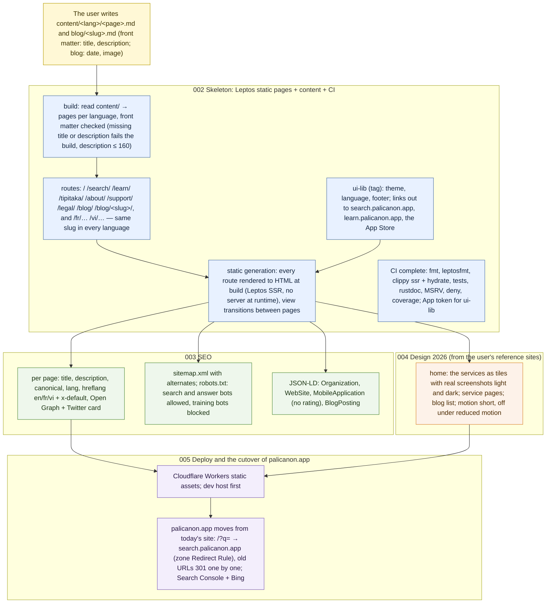

# 001 The showcase at palicanon.app — definition

status: design · rank: 6 · level: hard · type: feature (a new repository) · request: user, 2026-10-13 ("un site vitrine sur palicanon.app présentant les différents services. J'aimerais bien les écrire manuellement. Mais j'aimerais que tu fasses le SEO etc. Le design doit être façon website vitrine 2026.") · session: www-001-showcase · process: ../../docs/workflows/requirements.mmd, then development-process.mmd

## Summary
Rank: difficulty 5 (a new repository and its stack, static generation in three languages, SEO done properly, a design to define, the cutover of palicanon.app from today's site with its old URLs), impact 7 (the project's front door and its search ranking; a wrong cutover breaks every link to palicanon.app) → 6. Level hard: a domain cutover.
Ground (docs decisions.md 2026-10-08): `www` serves palicanon.app, presents the services and links to them (search.palicanon.app, learn.palicanon.app); today's site (palisearch `web/`, React on Cloudflare Pages) keeps palicanon.app until then, and its `/?q=` redirects to search.palicanon.app. repos.md: `www` is static, holds no search and no service.
The user writes the content by hand; the orchestrator's side: structure, SEO, the build, the design, the deploy.

## Requirements
(answers written here as they come, before anything is drawn — prompts/requirements/product.md)

Round 1 (user, 2026-10-13):
- Languages: en, fr, vi; `/`, `/fr/`, `/vi/`.
- Structure: a home page presenting each service briefly, a page per service, and a blog (news, guides).
- v1 content: the search, learning Pāli, the Tipiṭaka iPhone app, the project and support (who, why, free and non-commercial, Ko-fi, Instagram, the legal pages).
- Writing: Markdown in the repository, one file per page and language; the site rebuilds on push.

Round 2 (user, 2026-10-13):
- Stack: "un truc vraiment propre. Ce serait bien en Leptos, façon Astro pour la nav/design" — Leptos with ui-lib, generated statically, with Astro-like navigation and design (pages pre-rendered, view transitions between pages, content from Markdown files at build time). The Zola / Astro recommendation is ruled out by the user.
- Design: the user shows reference sites; the design starts from them (pending).
- AI crawlers: search and answer bots allowed (they cite), training bots blocked (GPTBot, CCBot, Google-Extended, ClaudeBot's training use…) in robots.txt.
- Links between services: "le site vitrine avec un lien vers les sous-domaines, le site du sous-domaine lui a dans le site lui-même les autres liens vers les sous-domaines" — the showcase links to each service; each service links to the others from inside (ui-lib's rail entries, memory nav-rail-services), and back to the showcase. The old URLs of today's palicanon.app: not answered (the 2026-10-08 decision stands: `/?q=` redirects to the search; the rest asked again at the cutover).

Scope (user, 2026-10-14: "la recherche et le site vitrine sont différentes choses. La vitrine présentera et renverra vers le site web"): the showcase and the search are two separate sites. The showcase presents each service and links to its site; the SEO work of this task is the showcase's only. The search's own SEO is out of scope.

Research (researcher, discussion #5942–#5944): a content-first page, a bento of three tiles (Search, Learn, Tipiṭaka) with real screenshots light and dark, a phone frame for the iOS app only, short motion under reduced-motion, no testimonials or counters; SEO checklist (hreflang both ways + x-default in the sitemap, self-canonicals, OG per page, JSON-LD Organization/WebSite/MobileApplication without a fabricated rating, no SearchAction effect since 2024-11, `/?q=` needs a zone Redirect Rule, 301 per old URL, Search Console domain property + Bing); stack recommendation Zola + Tailwind 4 standalone on Cloudflare Workers static assets (alternatives Astro, Leptos SSG); targets LCP ≤ 2.5 s, INP ≤ 200 ms, CLS ≤ 0.1, Lighthouse 100, WCAG 2.2 AA (gold on parchment contrast, focus not hidden, 24 px targets, lang per page, Pāli and Vietnamese diacritics in the font).

## Requirements draft (step 4)
- **The need**: palicanon.app presents the PaliCanon services and links to their own sites; the user writes every page in Markdown, the team builds the site, its SEO, its design and its deploy.
- **Content**: `content/<lang>/{index,search,learn,tipitaka,about,support,legal}.md` and `content/<lang>/blog/<slug>.md` (README "Writing the content"); front matter `title`, `description` (≤ 160), blog `date`, optional `image`. The three languages of a page share its file name.
- **Acceptance**: every page in en/fr/vi at `/`, `/fr/`, `/vi/`; a missing title or description fails the build; Lighthouse 100 in the four categories on the home and a service page; hreflang both ways with x-default, valid sitemap with alternates, robots.txt with the AI policy, valid JSON-LD (Rich Results test), OG preview per page; works with no JavaScript; phone and desktop; the old `/?q=` links reach the search after the cutover.
- **Out of scope**: the search's own SEO; comments, newsletter, analytics with cookies; a CMS.
- **Open**: the design (the user's reference sites); the dev host of the showcase; the list of today's site URLs to redirect (at 005).
- **Cut** (viewer design v1): 002 skeleton (static pages, content, ui-lib, CI) → 003 SEO and 004 design in parallel → 005 deploy and cutover.

## Design
Viewer: www-001-showcase/design v1 (to consensus).

## Log
| Step | Result | Output |
| --- | --- | --- |
| Ground | done | orchestrator, 2026-10-13: decisions 2026-10-08, repos.md; no `www` repository yet (local folder holds this task file only, no remote) |
| Research | done | researcher: discussion #5942–#5944 |
| Questions round 1 | done | languages, structure (with a blog), v1 content, Markdown |
| Questions round 2 | done | stack Leptos (Astro-like), design from the user's examples (pending), AI: search yes training no, links between services |
| Scope | done | user, 2026-10-14: showcase and search are separate; SEO here is the showcase's |
| Repo init | done | 2026-10-14: PaliCanon/www created (private), CLAUDE.md, README (content layout), LICENSE, the 21 empty pages pushed (848d449); docs 36de594 (repos.md, task-check REPOS); viewer workspace www existed. CI and main protection come with 002 (the crate). |
| Requirements draft | done | this file; design v1 to consensus |
