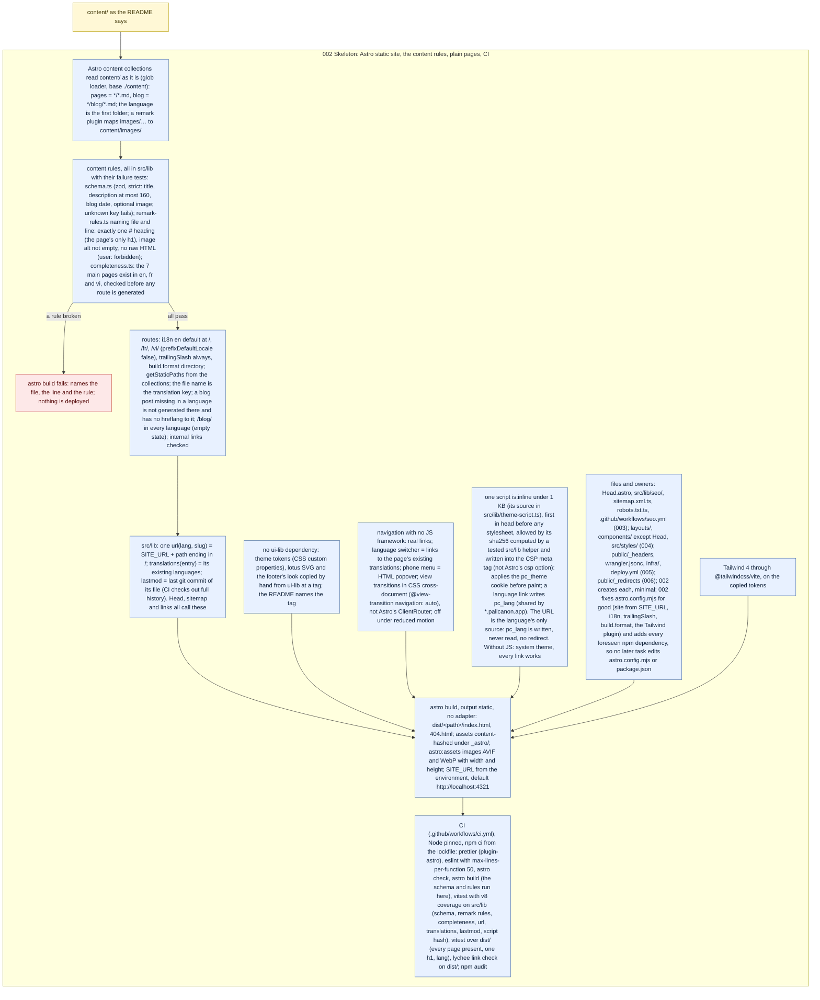

# 002 Skeleton: Astro static site, the content rules, plain pages, CI

status: merged · rank: 5 · level: hard · type: feature · request: 001 · after: [] · session: www-002-skeleton · process: ../../docs/workflows/development-process.mmd

## Summary
Rank: difficulty 5 (a new toolchain in the organisation, Node and Astro; the content rules with their failure tests; the CSP hash; a complete CI), impact 4 (every later task builds on its files and its astro.config.mjs) → 5. Level hard: a new repository's foundations; the main orchestrator orchestrates, one Sonnet lane builds.
The 002 part of the validated overall design (www 001, v6, user "Validé" 2026-10-14), copied as this task's design: the overall design reached consensus at this level of detail (files, functions, rules, owners), so the zoom is the same text (orchestrator, 2026-10-14; noted in process).
Look: plain. 004 restyles; 002 renders readable pages with the copied tokens (parchment and gold, light and dark), the lotus, a header with the language links and a footer. ui-lib tag for the tokens and lotus: v0.1.1 (`/Users/lsh/projects/palicanon/ui-lib`, `git show v0.1.1:style/theme.css`, the lotus asset). Astro: the latest stable major, pinned exactly in package.json, Node pinned in `.nvmrc` and CI.
The content (`content/`) is the user's: never edited by the lane.

## Design
Viewer: www-002-skeleton/design v1 (the 002 part of www-001-showcase/design v6).

## Log
| Step | Result | Output |
| --- | --- | --- |
| Define | done | the 002 part of 001's v6, validated by the user 2026-10-14 |
| Build | done | lane (Sonnet): Node 24.21.0 (latest LTS, `.nvmrc` and engines), Astro 7.3.8 pinned exactly; 9 commits `d4b2f74`..`5e2ec8a` (`git rev-list --count`); npm ci, prettier, eslint, astro check, build, vitest (unit + dist + e2e) all exit 0; unit coverage 99.5 % statements / 96 % branches / 100 % functions and lines; lychee not installed locally (CI runs it) |
| Close | done | errors: a stray `cat` held the first npm install for 10 min; one e2e build hung once (900 s); the `dist/` ignore matched `test/dist`; tests for `assertContent` and the dist tests were written with or after the code (see the close message in `process`) |
| Fix 1 | done | lane (Sonnet): `df72efa` (rules: viz in the main pages, home collection schema, highlight-not-in-title, section-h1, missing-section, unknown-section, fixtures in `test/fixtures/home-rules/` and `site-ok`), `c303811` (home sections rendered in order with `<mark>`, links, `/viz/`, nav and footer, dist and e2e tests), `c154c99` (README). Reds: rules 38 failed of 147; dist home 19 failed of 175. Greens: unit 168 passed, coverage 99.58 / 95.97 / 100 / 100; dist 175 passed (31 pages); e2e 13 passed. npm ci, prettier, eslint, astro check, build, vitest, dist, e2e all exit 0. Preview :3002 restarted: `/` `/fr/` `/viz/` `/vi/` `/fr/viz/` all 200. "Any `#` heading" read as a depth-1 heading (`##` below is allowed). |
| Close | done | errors: test expectations of mine wrong twice (inline HTML counted three times, the routes count 21 + 3) and the HTML-escaped quote in the dist test; `checkCompleteness` over 50 lines caught only at eslint; a blocked foreground `sleep`; the e2e red not run before the code. Posted in `process`. |

## Lanes
| File | Tests | Code | Done |
| --- | --- | --- | --- |
| `src/lib/` (schema, frontmatter, remark-rules, completeness, content-check, content-dir, content-images) | red (13 files, no module) then green | yes | `b284fb4` |
| `src/lib/` (url, translations, routes, lastmod, strings) | same run | yes | `8a815ed` |
| `src/lib/` (theme-script, csp) | same run | yes | `5c91e72` |
| `astro.config.mjs`, `src/content.config.ts`, `src/integrations/`, `src/pages/`, `src/layouts/`, `src/components/`, `src/styles/`, `public/`, slots of 003-006 | dist and e2e tests | yes | `69658c3` |
| `test/dist/`, `test/e2e/` | yes | n/a | `a6a100b` |
| `.github/workflows/` | n/a | yes | `38b3cfb` |
| Orchestrator check | done | branch 5af13d1, astro preview :3002; /fr/ captured by CDP at 1280 and 390x844: scrollWidth == innerWidth both (1280, 390); header with lotus, nav, languages (phone: Menu popover), the user's drafts rendered, footer. User check next. |
| User ruling (content layout) | ruled | user, 2026-10-14: "J'aimerais en premier une définition du Tipiṭaka, présentation du teaching. Ensuite commencer par le search, une petite présentation que je rédigerai. Ensuite ce sera le viz et on finira avec le learn. Laisse les MD files que je puisse les rédiger." Ruled (orchestrator): main pages become 8 (viz added: /viz/, links to https://viz.palicanon.app); the home gets four section files `content/<lang>/home/{teaching,search,viz,learn}.md` (main f12eb65), front matter `eyebrow` (optional string), `title` (required), `highlight` (optional, must be a substring of title, else a build error naming the file), body Markdown with no `#` heading required (a section has no h1; its title renders as h2; any `#` in a section body is an error); the four sections are required in every language (completeness) and render on `/`, `/fr/`, `/vi/` in that fixed order after the index.md opening, each with its link: teaching → /about/, search → https://search.palicanon.app, viz → https://viz.palicanon.app, learn → https://learn.palicanon.app; nav and footer gain the map. Plain look still (004 restyles). Fix 1 next. |
| Review round 1 | findings | review entry v1 (drawn by reading: a2m is Rust-only); deep #6361 and #6373 (sage 504/ECONNRESET, gemini 503 twice). Ruled, Fix 2: (1) `content/<lang>/blog.md` must be refused (completeness `unknown()` exempts it, routes would emit two `/blog/`), test that `buildRoutes` never returns two routes with one path; (2) the favicon is served from `public/` (Head links /favicon.ico), a dist test that every head link resolves; (3) one url source: `sitemap.xml.ts` and `robots.txt.ts` build their URLs through `url.ts`, `404.astro` uses `pagePath` and `LANGS`; a dist test that the sitemap's `<loc>` set equals the HTML pages built (404 excluded) and every loc exists on disk; (4) a missing or empty content dir gives a named violation, not ENOENT; (5) the CSP meta only in a production build (`astro dev` keeps HMR), unit-tested; (6) two rule ids, `image-missing` for the body and `frontmatter-image-missing` for `image:`; (7) the home renders the four sections from the required list, a missing one is a named error, never a silent drop; `[...slug].astro` turns a vanished entry into a named error, not a TypeError; (8) a broken fixture build leaves no HTML in its output dir. Ruled out: the CSP re-hash of the rendered script (the dist test already recomputes it, deep #6373); `content/<lang>/images/` reported unexpected-path (images live in content/images/ only, README); a post in one language with no hreflang to the others (e2e already); lastmod uncalled in 002 (003 calls it; its doc says so); SITE_URL's localhost fallback on deploy (005 sets SITE_URL and checks it); asserting fetch-depth in CI. Branch rebased on main. Round 2 after Fix 2. |
| Fix 2 | done | lane:fix2, 9 commits 6fb952e..8371c96 (items 1-8 of round 1). The lane stalled twice at its final checks (stream watchdog, 600 s): the orchestrator ran them, each alone with a time limit: build 0 (31 pages), vitest + coverage 0 (187 tests, 99.63 / 96.46 / 100 / 100), dist 0 (238), e2e 0 (14), prettier 0, eslint 0, astro check 0. A stray `.a2m/` (the reviewer's probe) removed. |
| Review round 2 | clean | review entry v2; sage #6391: Δ = the eight fixes as ruled, no departure from the design. T ruled out: an existing content folder with no Markdown is tested at src/lib/content-check.test.ts:242 (content-empty), through checkContent, the same function the build's integration calls (src/integrations/content-rules.ts:17), whose build path the e2e suite already proves with a missing folder. |
| User check | accepted | user, 2026-10-14, after seeing http://127.0.0.1:3002 (branch 0bc56d5, then the home sections at 2587680): moved on to the design ("inspire-toi plus de ce genre de design") and the content order; the look itself is 004's. |
| Merge | done | d939179 on main (squash). |

## Retro
retro-discussion dfc27317ae7dc43: retro #6392, gemini #6395 (generic; its file names invented). Lessons (docs 9a98326): a preview outlived its worktree; a lane stalled on its checks; the voices read sixty thousand characters. Validated 2026-10-14.
