# 006 Cutover: palicanon.app serves the showcase

status: merged · rank: 8 · level: hard · type: infra · request: 001 · after: [005] · session: www-006-cutover · process: ../../docs/workflows/development-process.mmd

## Summary
Rank: 8 since review round 2 (a second round with a medium finding: the prod job's test:dist step has no SITE_URL, so the build-form test fails by construction on the tag). Was 7 since review round 1 (a medium finding: C1 built two of its five checks). Was 6: difficulty 5 (two tofu states, the zone's rules, the apex certificate, old URLs and their ranking), impact 7 (the project's front door moves; a wrong redirect loses the search's traffic) → 6. Level hard: the orchestrator itself; the user applies what the token cannot (Pages, rulesets) and runs the palisearch destroy.
Request (user, 2026-10-16): "deploy la vitrine" after "la vitrine est bien sur palicanon.app ?" — the showcase takes palicanon.app (001 v6 node CUT: "tag builds with SITE_URL https://palicanon.app and deploys prod; palicanon.app moves from today's site: /?q= to search.palicanon.app (zone Redirect Rule), old URLs 301 one by one (public/_redirects), www to apex; Search Console + Bing").
Today: palicanon.app and www.palicanon.app are Pages custom domains of `palicanon-web` with CNAME records in palisearch's tofu (`cloudflare_pages_domain.apex/.www`, `cloudflare_record.apex/.www`); the old site's routes: `/` (`?q=` searches), `/acknowledgements`, `/terms`, `/privacy`, `/legal`, `/support` (web/src/components/Footer.tsx). The showcase has `/support/` and `/legal/`; search.palicanon.app has acknowledgements, terms, privacy. www-prod exists since the v0.1.0 tag (this task's first step, no public effect). Rights: the Cloudflare token (keychain) edits DNS and Workers, not Pages nor rulesets; a destroy apply by the orchestrator is refused by its permission mode (049): the user runs `tofu apply` in palisearch and sets the two Redirect Rules in the dashboard; the orchestrator applies the saved plan for the Workers domain (as for dev, user: "fais-le manuellement").
Open: the exact form of the `/?q=` rule (dynamic redirect preserving the query); whether www.palicanon.app keeps a record (a redirect needs a proxied record); the day Search Console is told.

## Log
| Step | Result | Output |
| --- | --- | --- |
| Prod upload | done | 2026-10-16: tag v0.1.0 pushed, deploy.yml prod job (www-prod, no domain). |
| Define | done | orchestrator, 2026-10-16: design v1 from 001's CUT node; consensus v3 (deep, sage, #10735) landed after the window had run on the user's word: ruling in ## Design. |
| N4 old URLs | built | lane:cutover, 2026-10-16, feat/cutover-redirects 0634107: `public/_redirects` (six 301 rules, absolute targets, both slash forms), the IndexNow key file carried over (`cmp` equal to palisearch's). Red first, `test/dist/redirects.test.ts` on a build with the comment-only file: `AssertionError: expected [] to deeply equal [ { …(3) }, … ]` (rules), `expected 0 to be greater than 0` (targets), `expected false to be true` (key in dist): 3 failed, 1 passed. Green: 4 passed. |
| P2 prod-build dist test | built | 60f8eff: `test/dist/build-form.test.ts`, one describe that reads the home's canonical host (prod set on palicanon.app, dev set otherwise: noindex after `scripts/noindex.sh` on a copy of `_headers`). Red on the prod build by mutation: `scripts/noindex.sh dist` gave `AssertionError: expected '/*\n  x-robots-tag: noindex\n  x-fram…' not to contain 'x-robots-tag'`; one sitemap URL on dev.palicanon.app gave `AssertionError: https://dev.palicanon.app/fr/about/: expected false to be true`. Its first run also failed on the dev build, on the word in `_headers`' own comment: the test now reads non-comment lines. Green: 5 passed on the dev build, 5 on the `SITE_URL=https://palicanon.app` build. |
| C1 deploy-check index form | built | 8443e4a: `moved` (301 + exact location on the search) for /acknowledgements /terms /privacy, `stays` (curl -L, final 200 on the origin) for /support /legal, index form only. Red first, shell test with the new cases on the old script: `FAIL prod: /terms answering 200 fails: exit 0 (want 1)`, 16 failed, 27 passed (26 before + the dev case). Green: `deploy-check.test: 43 passed, 0 failed`. The stub curl follows a `location` under `-L` (and into a `search…` response set for another host). |
| C3 prod host check | built | 8443e4a: deploy.yml prod job runs `scripts/deploy-check.sh https://palicanon.app index` after `wrangler deploy --env prod`, exit 3 a warning. Red first, `test/deploy.test.ts` (3 failed, 27 passed): `TypeError: Cannot read properties of undefined (reading 'run')` for the prod step. Green: 30 passed. Header comment and README's Deploying section updated. First exercised at the next tag. |
| N2 www record | built, not applied | 222aaa1: `cloudflare_record.www` (AAAA `100::`, proxied, ttl 1, zone `data.cloudflare_zone.site.id`), output `www_record`, infra/README. Red first, `test/infra.test.ts`: `AssertionError: expected [] to deeply equal [ 'www' ]` (3 failed, 7 passed). Green: 10 passed. `tofu fmt -check -recursive` exit 0 and `tofu validate` "The configuration is valid." on a scratch copy. The orchestrator applies it (`tofu plan`: 1 to add); the Redirect Rule is the user's. |
| Fix round 1 | done | lane:fix-1 (Sonnet), 6 commits on 052df4c: F1+F3+F5 4b925cb (`deploy-check.sh`: `/?q=metta`, `www.<host>/x?a=1`, `/daily.json`, the key file; `moved` follows to a final 200 in both forms; the stub fails at 5 hops), F2 cd95a0d, F4 af610e7, F6 340ce77, f458ae1 (stub and `header()` on bash builtins, wrapper timeout 5 s to 60 s: the suite grew 43 to 62 cases and `test/deploy-scripts.test.ts`, a file outside the lane list, timed out at 5000 ms), 3b82508 README. **Red first.** Shell, new cases on the old script: `FAIL index: /terms redirecting to a 404 fails: exit 0 (want 1)`, `FAIL prod: /?q= redirecting elsewhere fails: exit 0 (want 1)`, `FAIL prod: www dropping the query fails`, `FAIL prod: /daily.json answering 200 fails`, `FAIL prod: the IndexNow key missing fails`, `FAIL noindex: the old URLs are asserted`; `deploy-check.test: 45 passed, 17 failed`. F2, a temporary `/legal /legal/ 301` in dist/_redirects on the old test: `AssertionError: /legal: expected [ { from: '/legal', …(2) } ] to deeply equal []`; on the new test: `Tests 1 passed`; a rule to `https://elsewhere.test/legal` still fails it. F4, the old test on the prod build with `SITE_URL=https://dev.palicanon.app`: `Tests 4 passed (4)` (the hole); the new one: `AssertionError: the build's canonical is https://palicanon.app, SITE_URL says https://dev.palicanon.app`; a home with no canonical: `the build's canonical is (none: the home has no canonical), SITE_URL says https://palicanon.app`. F6 was green at once (the prod step was already identical to dev's): the new test runs each step with the script stubbed to exit 0/1/2/3; red proof by mutating the prod step to `exit 0` after the `if`: `AssertionError: deploy-check exits 1: expected +0 to be 1`; deploy.yml unchanged. **Counts** (runner output): shell 62 passed 0 failed (was 43); `vitest run --coverage` 313 passed (31 files); dist suite dev build 1011 passed, `SITE_URL=https://palicanon.app` build 1010 passed (19 files each); `npm run lint` exit 0; `format:check` exit 1 on two untracked, gitignored a2m caches `.a2m/cache/refs/{2878460…,5f51010…}/index.json` (not in the diff; `prettier --check` on every file of the diff passes). Rebase on main: up to date. |
| Fix round 2 | done | lane:fix-2 (Opus), 4 commits on 39077b8: G1 52b9f53 (deploy.yml: both `npm run test:dist` steps carry the build's `SITE_URL`; header comment), G3 4ec24bf (`test/dist/redirects.test.ts`: the key file read as a Buffer is 32 bytes, `/^[0-9a-f]{32}$/`, the hex of its name), G4 e68eb9d (`stays` wants exactly `<origin><path>/`; README wording), G5 8addf30 (`fetch_final --max-redirs 5`; the stub honours `--max-redirs`, curl's default 50 when absent, and fails with curl's own `curl: (47) Maximum (N) redirects followed` instead of a stub message). **Red first.** G1: `AssertionError: expected undefined to be 'https://dev.palicanon.app'` (and `'https://palicanon.app'`), `Tests 2 failed | 32 passed (34)`. G3, a newline appended to the key file (33 bytes), restored with `cmp`: `AssertionError: expected 33 to be 32`, `Tests 2 failed | 3 passed (5)`; the file itself already conformed, so the test was green at once on the real file. G4: `FAIL prod: /support ending at /support/index.html fails: exit 0 (want 1)` (and /legal), `deploy-check.test: 62 passed, 2 failed`. G5: the stub's own 5-hop cap hid the missing flag; once the stub honoured `--max-redirs`, the three loop cases asserting `Maximum (5) redirects followed` read `curl: (47) Maximum (50) redirects followed`, `deploy-check.test: 64 passed, 3 failed`; green after the flag. **Counts** (runner output): shell 67 passed 0 failed (was 62); `vitest run --coverage` 315 passed (31 files; was 313); dist suite dev build 1012 passed, `SITE_URL=https://palicanon.app` build 1011 passed (19 files each; were 1011, 1010); `npm run lint` exit 0; `prettier --check` on the diff's non-shell files exit 0 (prettier has no parser for `.sh`). Rebase on main: up to date. |
| Fix round 3 | done | lane:fix-3 (Opus), 2 commits on da51b7f: H1 d1cbd75 (`moved`: after the 301 the final URL must be on https://search.palicanon.app, else `<path>: ends at <url> (want https://search.palicanon.app<path>)`; the stub picks its directories by host: the search, www, the origin, any other host by its name; header comments and README say the redirects end at a 200 on that host), H2 41ff75d (`/terms` -> search -> 4 hops within search.palicanon.app -> 200, exactly 5 redirects, exits 0, both forms). **The host is pinned, not the path**: the brief's "exactly `https://search.palicanon.app/<path>`" cannot hold with H2 (a 5-hop chain starting at `<search>/terms` cannot end there, the pages answer by path); the ruling's "final URL's host pinned" and H2's "on the right host" were built, the message keeps the brief's `(want https://search.palicanon.app<path>)`. Live today: `/terms`, `/privacy`, `/acknowledgements` on the search end `200 0 https://search.palicanon.app/<path>` (curl `%{num_redirects}` 0). **Red first.** H1 on the old script: `FAIL index: /terms ending at 200 on another host fails: exit 0 (want 1)` (and noindex), `deploy-check.test: 69 passed, 2 failed`. H2 green at once; red by mutation, `--max-redirs 4` in `fetch_final`: `FAIL index: /terms after exactly 5 redirects passes: exit 1 (want 0)` with `curl: (47) Maximum (4) redirects followed` (and noindex; the three loop cases asserting `Maximum (5)` fail too), `deploy-check.test: 66 passed, 5 failed`; restored to 5. **Counts** (runner output): shell `deploy-check.test: 71 passed, 0 failed` (was 67), exit 0; `vitest run --coverage` `Tests 315 passed (315)`, `Test Files 31 passed (31)`, exit 0; `npm run lint` exit 0; `npx prettier --check README.md test` exit 0. |

## Design
Viewer: www-006-cutover/design v5 (d931c2adc362c4c): v3 consensus 2026-10-16, v4 N4 amended at round 1, v5 C1 amended at round 2 (deep, sage; summary #10735). **Orchestrator's ruling on arrival**: the window ran before the consensus landed, on the user's word ("attache palicanon.app à la vitrine"), in this order: the user removed the two Pages custom domains (the CNAMEs went with them), the orchestrator applied the saved www/infra plan (`cloudflare_workers_domain.prod`, 8636ab4d…), palisearch 050 removed the four resources from config and state. So the design's window nodes (O1/O2/N1, S1 spike, W-fast/W-gap, RB1) are superseded by what happened; the www CNAME the design keeps as a placeholder is gone too: N2 needs a proxied record for www (an AAAA `100::` in www/infra). Everything else of v3 stands and is what remains to build: N2 (record + the user's rule), N3 (the user's rule), N4 `_redirects` (absolute targets, both slash forms, 301; the IndexNow key file `ea61cff5ec8386a25c60f8d2ea079010.txt` carried over), P2 prod-build dist test, C1 old-URL assertions in deploy-check (index form), C3 the prod host check in deploy.yml, PG purge, C2 Search Console and Bing, O3 (delete the Pages project after 7 days, a task of its own), F1 (learn-pali's footer and the app link palicanon.app/terms and /privacy: follow-ups there).

```mermaid
flowchart TB
  subgraph PREP["1 Prepare: nothing public changes (the orchestrator and lanes)"]
    N4["N4 www/public/_redirects, one 301 per old URL, absolute targets, both slash forms: /acknowledgements /terms /privacy go to https://search.palicanon.app (same path); /legal goes to /legal/ and /support to /support/ (301 over html_handling's 307); the IndexNow key file ea61cff5ec8386a25c60f8d2ea079010.txt is carried over; dist test on _redirects. Merged to main, deployed to dev, curled on dev.palicanon.app (redirects follow to a 200, no loop) before any tag — amended round 1 (deep #10796): /support and /legal keep html_handling's 307 to their slash form (same-host normalisation, like every page); N4's 301 rule is for paths that leave the host"]:::new
    P1["P1 tag v0.1.1 (v0.1.0 had no redirects): deploy.yml prod job, SITE_URL https://palicanon.app, no noindex, wrangler deploy --env prod uploads Worker www-prod, served nowhere yet"]:::new
    P2["P2 dist test on the prod build (SITE_URL set): canonical, hreflang and sitemap origin, robots Sitemap line, no X-Robots-Tag noindex, since www-prod has no workers.dev nor preview URL and nothing prod can be fetched before the domain"]:::new
    S1["S1 spike on a throwaway host (orchestrator, token): does PUT /workers/domains/records with override_existing_dns_record replace an existing CNAME in place? Written in the task file: yes means variant W-fast, no means W-gap"]:::new
    PF["PF preflight, read-only: search.palicanon.app /acknowledgements /terms /privacy answer 200; dig SOA palicanon.app; the saved plans exist (www/infra N1, palisearch O2: expected 1 destroy, 2 forgotten); the apex CNAME (to palicanon-web.pages.dev, proxied, TTL auto) copied aside; the Pages domain status of both hosts (active or pending) written down; a browser logged in to the dashboard"]:::new
  end
  subgraph RULES["2 Rules first (the user, dashboard): live on the old site, reversible by disabling"]
    N2["N2 zone palicanon.app, Rules, Redirect Rules, Create rule, template 'Redirect from WWW to root': when http.host eq www.palicanon.app, dynamic target concat(https://palicanon.app, http.request.uri.path), 301, Preserve query string on. The www CNAME in palisearch stays as a proxied placeholder (the rule answers before the origin), so www never has a gap and needs no new record"]:::user
    N3["N3 second Redirect Rule: when http.host eq palicanon.app and http.request.uri.path eq / and any(http.request.uri.args.names[*] eq q) (fallback if the editor refuses: http.request.uri.query contains q=), static target https://search.palicanon.app/, 301, Preserve query string on, so mode, c, chat and lang travel. From now on a search typed on the old site lands on search"]:::user
    NC["NC check: www.palicanon.app/x?a=1 gives 301 to https://palicanon.app/x?a=1; palicanon.app/?q=metta&mode=words gives 301 to search with the query intact; palicanon.app/ and /?lang=vi stay 200 (old site)"]:::new
  end
  subgraph WINDOW["3 The window (the user at a terminal, the orchestrator on the line, a quiet hour)"]
    O2["O2 palisearch: tofu apply of the saved plan: destroys cloudflare_record.apex only; removed blocks (destroy = false) forget cloudflare_pages_domain.apex and .www in state, no manual state rm; the Pages domains stay attached for now, the TXT google-site-verification stays"]:::user
    N1["N1 www/infra: tofu apply of the saved plan -var prod_host=palicanon.app: Workers domain prod to www-prod, Cloudflare creates the proxied apex record. W-fast variant if S1 said yes: the same attach with the override flag, no gap, then tofu import. If Cloudflare refuses because the Pages domain still holds the host: O1 first, then N1 again. If the apply errors after creating, never re-apply the saved plan: tofu plan afresh; a Workers domain the state does not know is deleted in the dashboard (Workers and Pages, www-prod, Settings, Domains and Routes) or tofu imported"]:::new
    N1C["N1C check at once: TLS valid on the apex (curl -sSI https://palicanon.app), the body is the showcase and not the old site (canonical https://palicanon.app/, no x-robots-tag). Abort rule: N1 failed twice, or TLS invalid ten minutes after N1, goes to RB. It is a point-in-time read, so it is repeated after O1 and after PG"]:::new
    O1["O1 dashboard: Workers and Pages, palicanon-web, Custom domains, remove palicanon.app and www.palicanon.app (the token lacks Pages rights); normally after N1C, so a rollback may stay cheaper; then N1C is run again, because Pages must not write the apex back"]:::user
    PG["PG purge by hostname, then N1C a third time: Caching, Configuration, Purge Cache, Custom Purge, Hostname palicanon.app, so no old Pages object (robots, sitemap, images) is served from the edge"]:::user
  end
  subgraph CHECK["4 Check and SEO"]
    C1["C1 from the laptop (the runner is challenged: 009): scripts/deploy-check.sh https://palicanon.app index plus every old URL: /acknowledgements /terms /privacy give 301 to search.palicanon.app and a final 200; /legal and /support give 301 and a final 200 on the showcase; /?q=metta gives 301 to search; www gives 301; /daily.json gives 404 (data of the old site, dropped) — amended round 2 (deep #10899): /support and /legal end on their slash form through html_handling's 307, a final 200 on this host; the 301 + final 200 rule is for the three paths leaving the host"]:::new
    C2["C2 Search Console, domain property palicanon.app (already verified, covers every host): Sitemaps, add sitemap.xml; URL inspection, Request indexing for / , /fr/ , /vi/ ; Bing Webmaster: import from Search Console, submit the sitemap. Old URLs will list as Page with redirect, expected. The user"]:::user
    C3["C3 deploy.yml prod job gains the host check (the custom domain exists now): deploy-check prod form; first exercised at the next tag"]:::new
  end
  subgraph AFTER["5 After"]
    O3["O3 the Pages project palicanon-web stays seven days, then is deleted with its secret API_TOKEN revoked (a task of its own, with palisearch)"]:::keep
    F1["F1 follow-ups: learn-pali and the app footers link palicanon.app/terms and /privacy: repoint to search.palicanon.app directly; docs: project diagrams and decisions"]:::keep
  end
  subgraph RB["Rollback (the user), by how far the window went"]
    RB1["RB1 before N1 succeeded: recreate the apex CNAME to palicanon-web.pages.dev, proxied, from the saved copy (dashboard DNS: a minute for the record, then Pages revalidates the domain within minutes); if PF's note says the Pages domain went inactive meanwhile, add the domains again in the Pages dashboard and wait for the certificate (the back half of RB2)"]:::user
    RB2["RB2 after N1: tofu apply -var prod_host=null in www/infra (a destroy, the user runs it), then RB1; if O1 is done, re-add both domains in the Pages dashboard (certificate reissue, minutes). Rules N2 and N3 may stay: they only point at search"]:::user
  end
  N4 --> P1 --> P2 --> PF
  S1 --> PF
  PF --> N2 --> N3 --> NC --> O2 --> N1 --> N1C --> O1 --> PG --> C1 --> C2 --> C3 --> O3
  C3 --> F1
  O2 -.-> RB1
  ST["ST stop rule: no step starts before the previous check is green. A red PF or NC stops before the window (fix, or disable the rules). A red N1C goes to RB. A red C1 on a redirect is fixed forward (patch _redirects, a new tag, nothing is rolled back); a red C1 on the showcase itself goes to RB2. A failed C2 or PG retries later, nothing is lost"]:::keep
  PF -.-> ST
  NC -.-> ST
  C1 -.-> ST
  N1C -.->|abort rule| RB2
  classDef done fill:#1f3a2a,stroke:#6c6,color:#dfd
  classDef new fill:#1f2d3a,stroke:#6af,color:#dff
  classDef user fill:#3a2f1f,stroke:#fc6,color:#ffd
  classDef keep fill:#2b2b2b,stroke:#888,color:#ddd
```

| N1 palicanon.app → www-prod | done | 2026-10-16: the user removed the two Pages custom domains (the CNAMEs went with them; the zone keeps the Google TXT); palisearch 050 merged (config) and the four resources removed from its state; `tofu apply` of the saved plan (`prod_host=palicanon.app`): `cloudflare_workers_domain.prod` created (8636ab4d…). Live: `/`, `/fr/`, `/vi/`, `/tipitaka/`, sitemap, robots 200, no x-robots-tag; `/support` and `/legal` 307 to their slash form; `/terms` 404 until N4's `_redirects`. |

## Reviews
### Round 1 — 2026-10-16
Graph v1 (d9f66cc35979641); deep #10796, sage #10816 (blind to each other). Rank 6 → 7: C1 built two of its five checks (medium).

**In — Fix round 1**
- F1 (deep 1, sage T1–T3) `scripts/deploy-check.sh` index form: add `/?q=metta` → 301 whose `location` starts with `https://search.palicanon.app/?` and carries `q=metta`; `www.palicanon.app/x?a=1` → 301 to `https://palicanon.app/x?a=1` (the host is derived from the origin); `/daily.json` → 404; and `moved` follows the 301 to a final 200 (`fetch_final`) — a 301 whose target 404s fails. Shell test cases for each (pass and fail).
- F2 (deep 2) `/support` and `/legal`: the 307 to the slash form is correct (same-host normalisation); N4 amended in the design (v4). `test/dist/redirects.test.ts` forbids only rules that leave the host for a path the site serves.
- F3 (deep 3) the noindex form also follows the three old URLs to a final 200 (the `_redirects` are the same on dev; the targets are the prod search), so dev verifies N4 before a tag; the curl stub fails at its 5-hop cap instead of returning the last response.
- F4 (deep 5) `test/dist/build-form.test.ts`: the expected origin comes from `SITE_URL` (default `http://localhost:4321` as astro.config), the test asserts the canonical equals it, and the prod set runs when `SITE_URL` is `https://palicanon.app`; a build with no canonical fails with a named assertion, not a `new URL('')` TypeError.
- F5 (deep 6) the index form curls `/ea61cff5ec8386a25c60f8d2ea079010.txt`: 200 and the 32-byte key.
- F6 (sage T5) `test/deploy.test.ts`: assert the prod job's check step exits with the script's status when it is not 3 (009 wrote the dev step; the prod step must match).

**Out, with the reason**
- deep 4 (record then rule, a no-origin window on www): process, not code — the orchestrator applies the www record right before the user sets the rule, the task file notes the order; `www.` is 530 today anyway.
- sage Δ (`output www_record`): an output is tooling, not a design element.
- sage T4 (cf-mitigated → exit 3 → warning): 009 built and tested it; the prod step reuses the block (F6 asserts the non-3 path).

### Round 2 — 2026-10-16
Graph v2; deep #10899 (the review), sage #10926 (a reading: Δ none, a T list restating the tests). Rank 7 → 8 (a medium finding, a second round).

**In — Fix round 2**
- G1 (deep Δ1; medium) `.github/workflows/deploy.yml`: the `npm run test:dist` step of both jobs carries `env: SITE_URL` (the same value as the build step), otherwise `build-form.test.ts` fails by construction on a tag (its canonical is prod, `siteUrl()` says the default). `test/deploy.test.ts` asserts the test step's env equals the build step's in each job.
- G2 (deep Δ2) C1's wording amended in the design (v5): `/support` and `/legal` end on their slash form (307, html_handling) with a final 200 here; the 301 + final 200 rule is for the three paths leaving the host. Code unchanged.
- G3 (deep T4) `test/dist/redirects.test.ts`: `public/ea61cff5ec8386a25c60f8d2ea079010.txt` is exactly 32 bytes of `[0-9a-f]` with no trailing newline (the script compares the served key with that file: the file itself is pinned).
- G4 (deep T5) `deploy-check.sh` `stays`: the final URL of `/support` and `/legal` is exactly `<origin>/support/` and `<origin>/legal/` (not any URL under the origin); a shell case with a final `/support/index.html` fails.
- G5 (deep T6) `fetch_final` gets `--max-redirs 5` so a real loop ends as the stub does; the loop case asserts the script's own message.

**Out, with the reason**
- deep T3 (the first prod run before the user's rules exist fails with 1, not 3): an absent rule is a real failure of the cutover, not a challenge; the rules are set and checked from the laptop (C1) before the tag — the order is this task's Log, not a code path.
- the thread rank (6) vs the task (8): `GET /settings` gives the same models at 6–8; set at the next summons by the reviewer.
- the reviewer's finding on the viewer (`chat()` keeps the last 12 messages before the 60,000-character trim: the window is the smaller of the two): a docs fix at the retro (review.md §4, tools/viewer.md, the lesson written today).

### Round 3 — 2026-10-16 (the last)
Graph v3; deep #11064 (Δ none: G1, G3, G4, G5 built as ruled), sage #11080 (its Δ are the user's dashboard rules — not code — and a `/daily.json` case that exists at :349, outside the range it saw). Rank stays 8.

**In — Fix round 3** (tests and one bound; the orchestrator reads the diff, three rounds done)
- H1 (deep T1) `moved`: the final 200 must be on `https://search.palicanon.app` (the final URL's host pinned, as `stays` pins the slash form); a shell case: `/terms` → search → `elsewhere.test/terms` 200 fails.
- H2 (deep T2) the pass side of the cap: a 5-hop chain ending at 200 exits 0 (shell case).

**Follow-up** (`followup-deploy-check-cases` in the session): deep T3 (a 3-hop chain on the search's side still passes within the cap), T4 (the www and query rules sampled on one path each: a multi-segment `www.<host>/support/` and the `mode`, `c`, `lang` args), T5 (the stub's default `--max-redirs` branch unexercised).
| Fix round 3 read | done | orchestrator, 2026-10-16: diff da51b7f..7db2468 read — `moved` pins the final URL's host to search.palicanon.app (the brief's "exact path" contradicted H2's five-hop chain: the host pin is the ruling, accepted), the stub picks pages by host, the five-hop pass case; 71 shell cases, 315 unit. Three rounds done. Merge; then the www record applied, the user's rules checked from the laptop (C1), tag v0.1.1. |

## Merge
b6828aa on main, 2026-10-16.

## After the merge
- 2026-10-16: `cloudflare_record.www` applied (5f0e11fd…); tag v0.1.1 → the prod job green (the runner's host check was challenged → warning); live: `/terms`, `/privacy`, `/acknowledgements` 301 to search.palicanon.app, the IndexNow key 200, `/daily.json` 404. Still the user's: the two Redirect Rules (`/?q=` → search, www → apex: `/?q=metta` answers 200 and www does not answer yet), the purge, Search Console and Bing; then C1 from the laptop. O3 (delete the Pages project after 7 days, revoke its API_TOKEN) and F1 (learn-pali's footer and the app link palicanon.app/terms and /privacy) are follow-ups to open.
