# 006 Cutover: palicanon.app serves the showcase

status: design · rank: 6 · level: hard · type: infra · request: 001 · after: [005] · session: www-006-cutover · process: ../../docs/workflows/development-process.mmd

## Summary
Rank: difficulty 5 (two tofu states, the zone's rules, the apex certificate, old URLs and their ranking), impact 7 (the project's front door moves; a wrong redirect loses the search's traffic) → 6. Level hard: the orchestrator itself; the user applies what the token cannot (Pages, rulesets) and runs the palisearch destroy.
Request (user, 2026-10-16): "deploy la vitrine" after "la vitrine est bien sur palicanon.app ?" — the showcase takes palicanon.app (001 v6 node CUT: "tag builds with SITE_URL https://palicanon.app and deploys prod; palicanon.app moves from today's site: /?q= to search.palicanon.app (zone Redirect Rule), old URLs 301 one by one (public/_redirects), www to apex; Search Console + Bing").
Today: palicanon.app and www.palicanon.app are Pages custom domains of `palicanon-web` with CNAME records in palisearch's tofu (`cloudflare_pages_domain.apex/.www`, `cloudflare_record.apex/.www`); the old site's routes: `/` (`?q=` searches), `/acknowledgements`, `/terms`, `/privacy`, `/legal`, `/support` (web/src/components/Footer.tsx). The showcase has `/support/` and `/legal/`; search.palicanon.app has acknowledgements, terms, privacy. www-prod exists since the v0.1.0 tag (this task's first step, no public effect). Rights: the Cloudflare token (keychain) edits DNS and Workers, not Pages nor rulesets; a destroy apply by the orchestrator is refused by its permission mode (049): the user runs `tofu apply` in palisearch and sets the two Redirect Rules in the dashboard; the orchestrator applies the saved plan for the Workers domain (as for dev, user: "fais-le manuellement").
Open: the exact form of the `/?q=` rule (dynamic redirect preserving the query); whether www.palicanon.app keeps a record (a redirect needs a proxied record); the day Search Console is told.

## Log
| Step | Result | Output |
| --- | --- | --- |
| Prod upload | done | 2026-10-16: tag v0.1.0 pushed, deploy.yml prod job (www-prod, no domain). |
| Define | doing | orchestrator, 2026-10-16: design v1 drawn from 001's CUT node; consensus with the voices next. |

## Design
Viewer: www-006-cutover/design v1, 2026-10-16.

```mermaid
flowchart TB
  subgraph PROD["Prod upload (done first, no public effect)"]
    P1["tag v0.1.0 → deploy.yml prod job: build with SITE_URL https://palicanon.app (indexable: no noindex), wrangler deploy --env prod → Worker www-prod; no host check until the domain exists"]:::done
  end
  subgraph OLD["Free palicanon.app from the old site (palisearch infra, the user's rights)"]
    O1["Pages custom domains palicanon.app and www.palicanon.app removed from project palicanon-web (dashboard: the token lacks Pages rights); then tofu state rm cloudflare_pages_domain.apex / .www"]:::user
    O2["DNS records @ and www (CNAME → palicanon-web.pages.dev) destroyed: tofu apply in palisearch (the user runs it; the orchestrator's apply is refused) — the TXT google-site-verification stays"]:::user
    O3["the Pages project palicanon-web stays until the showcase is checked live (rollback: re-add the domains); deleted later"]:::keep
  end
  subgraph NEW["palicanon.app on the showcase (www infra + zone)"]
    N1["tofu apply -var prod_host=palicanon.app in www/infra (a saved plan): cloudflare_workers_domain.prod → www-prod; Cloudflare issues the apex certificate"]:::new
    N2["www.palicanon.app → https://palicanon.app/$1 301: a second Workers domain on www-prod is not a redirect; use a zone Redirect Rule (dashboard Rules → Redirect Rules: www.palicanon.app/* → https://palicanon.app/${1}, 301, preserve query) and a proxied DNS record for www (AAAA 100:: or the Workers domain) — the user, the token lacks rulesets"]:::user
    N3["/?q= → the search: zone Redirect Rule: hostname palicanon.app, path /, query contains q → https://search.palicanon.app/?${query} 301 (dynamic, preserve query string) — the user"]:::user
    N4["old URLs 301 in public/_redirects (Workers static assets honour _redirects): /acknowledgements, /terms, /privacy → https://search.palicanon.app/<same> ; /legal → /legal/ ; /support → /support/ ; with a dist test on _redirects and the deploy-check asserting one 301"]:::new
  end
  subgraph CHECK["Check and SEO"]
    C1["scripts/deploy-check.sh https://palicanon.app (no noindex: the prod form asserts no x-robots-tag) from the laptop (the runner is challenged: 009); curl of /?q=metta → 301 to search; www. → apex; /terms → 301"]:::new
    C2["Search Console: palicanon.app property verified by the TXT already in the zone; submit https://palicanon.app/sitemap.xml; Bing Webmaster the same — the user"]:::user
    C3["deploy.yml prod job gains the host check (the custom domain exists now): deploy-check prod form"]:::new
  end
  P1 --> O1 --> O2 --> N1 --> N2 --> N3 --> N4 --> C1 --> C2 --> C3
  classDef done fill:#1f3a2a,stroke:#6c6,color:#dfd
  classDef new fill:#1f2d3a,stroke:#6af,color:#dff
  classDef user fill:#3a2f1f,stroke:#fc6,color:#ffd
  classDef keep fill:#2b2b2b,stroke:#888,color:#ddd
```

| N1 palicanon.app → www-prod | done | 2026-10-16: the user removed the two Pages custom domains (the CNAMEs went with them; the zone keeps the Google TXT); palisearch 050 merged (config) and the four resources removed from its state; `tofu apply` of the saved plan (`prod_host=palicanon.app`): `cloudflare_workers_domain.prod` created (8636ab4d…). Live: `/`, `/fr/`, `/vi/`, `/tipitaka/`, sitemap, robots 200, no x-robots-tag; `/support` and `/legal` 307 to their slash form; `/terms` 404 until N4's `_redirects`. |
